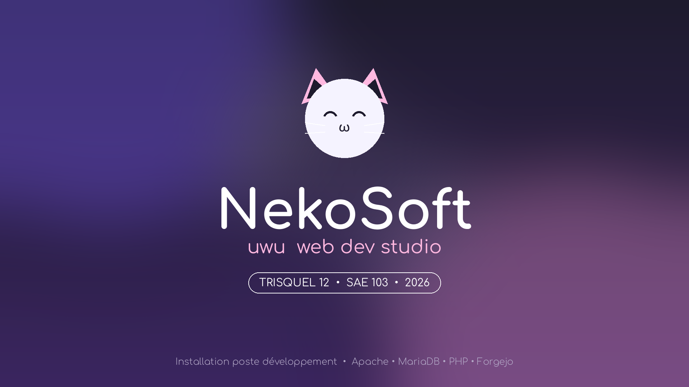

 # NekoSoft OS

**SAE 103**  
*Installation d'un poste pour le développement. Basé sur Trisquel 12.0 Mini*



# Installation

## Prérequis

1. Machine hôte Linux recommandée
2. Installer QEMU x86-64
3. ISO : **trisquel-mini_12.0_amd64.iso**
4. Installer Git
5. Avoir à minima 30 Go d'espace libre

> Vous pouvez installer Trisquel Mini 12 ici : [Trisquel Mini](https://trisquel.info/fr/download)

## Premier lancement

### Clonage du dépôt

```bash
git clone https://github.com/cazzuloa/nekosoft-OS.git
cd nekosoft-OS
```

> Assurez-vous d'avoir mis le .iso de Trisquel dans le dossier scripts.

### Création du disque virtuel

```bash
qemu-img create -f qcow2 trisquel-disk.img 20G
```

### Lancer le live boot

```bash
chmod +x ./scripts/boot-live.sh
./scripts/boot-live.sh
```
